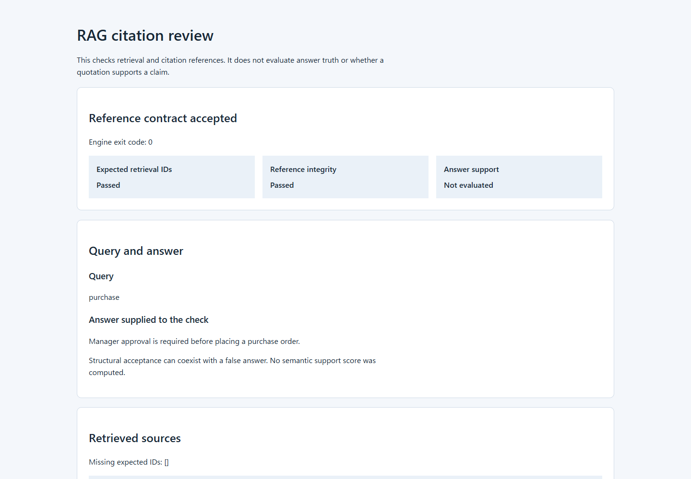

# RAG Citation Review

Inspect the sources and quotations attached to a supplied RAG answer in an
offline report. The Rust CLI checks that a source exists, was retrieved for the
query, has the expected version and SHA-256, and contains the exact quotation at
a valid UTF-8 byte span. Retrieval expectations and reference errors stay separate.

This package does not decide whether an answer is true or whether a quotation supports its claim. A deliberately false answer with an intact retrieved quotation is accepted structurally and reports `semantic_support: not_evaluated`.



The example above uses fictional purchase rules. It is a recorded local result,
not a customer deployment or an answer generated by an LLM.

## Review one result on Linux

Build both Rust executables with the existing lockfile, then save a new review bundle:

```sh
git clone https://github.com/skyon0522-ai/rag-citation-evaluator.git
cd rag-citation-evaluator
cargo build --locked --bins --manifest-path cli/Cargo.toml
./cli/target/debug/rag-citation-review examples/purchase-policy/corpus.json examples/purchase-policy/request.json review-valid
```

Open `review-valid/report.html` in a browser. On a machine without a graphical
browser, copy the bundle to one with a browser and keep its six files together.
The viewer shows retrieval, reference errors, requested quotations and the
unchanged engine result. It uses no JavaScript, server, model or account.
Both executables must remain together; the review tool calls the sibling
`rag-reference-contract` executable. Python is needed for fixture verification,
not for generating one report. Rust/Cargo 1.99.0 is the tested toolchain.

For use outside the checkout, copy **both** executables to the same directory
on this Linux machine, then pass paths to your corpus, request and new output
directory. This pair was tested outside the checkout; prebuilt binaries and
cross-distribution compatibility are not provided.

The bundle retains the exact corpus and request bytes, engine stdout/stderr,
execution receipt and HTML. It contains the full input data, including query,
answer and sources; inspect the contents before sharing. On Linux the tool
creates its output directory with mode 700 and files with mode 600. This does
not make the bundle immutable or authenticate its author.

Choose a new output path for each run. Existing files, directories and symbolic
links are refused before the engine runs. A storage failure may leave a partial
new bundle. Engine exit codes are retained: **0** means reference acceptance,
**1** rejection, **2** invalid input and **3** engine execution failure. Viewer
setup, output and protocol failures return **4**. Acceptance does not mean that
the answer is correct or supported.

## Three recorded examples

| Example | What to inspect | Expected exit |
| --- | --- | ---: |
| [Purchase policy](examples/purchase-policy/) | A quotation exactly matches a retrieved fictional policy. | 0 |
| [False answer](examples/false-answer/) | The answer contradicts that policy, but the intact reference still passes. Answer support remains unevaluated. | 0 |
| [Changed quotation](examples/rejected-quote/) | A supplied quotation differs from the source; the reference is rejected. | 1 |

Each directory contains the six recorded bundle files. Download or clone the
repository to open its `report.html` locally; GitHub displays HTML source.
Use a chosen example's `corpus.json` and `request.json` with the command above
and a new output directory. The full unchanged result is `engine-result.json`.

To supply your own input, follow the [purchase request](examples/purchase-policy/request.json)
and [corpus](examples/purchase-policy/corpus.json). Source hashes cover the UTF-8
source text; `corpus_sha256` covers the complete corpus file bytes. Quotation
positions are UTF-8 byte offsets. This tool inspects supplied answers; it does
not generate them or connect to a RAG service.

## Where to look

| Question | File |
| --- | --- |
| What does the evaluator actually check? | [CLI source](cli/src/main.rs) |
| How is its result displayed without changing the evaluator? | [Review wrapper](cli/src/bin/rag-citation-review.rs) |
| Which cases are run? | [Fixture manifest](cli/fixtures/cases.json) and [portable runner](verify-portable.sh) |
| Which code is copied or adapted? | [Provenance](PROVENANCE.md), [copied Tantivy](components/tantivy/) and [derivation diff](derivation.diff) |
| What passed, and what remains outside the claim? | [Verification](VERIFICATION.md), [fixture results](verification/fixture-results.json) and [research limits](RESEARCH.md) |
| How does CI reproduce the checks, and how are security concerns reported? | [Portable CI workflow](.github/workflows/portable.yml), [CI scope](VERIFICATION.md#continuous-integration) and [security policy](SECURITY.md) |

## Run the fixed checks

Requirements are Rust and Cargo compatible with Tantivy's declared Rust 1.86 minimum, plus Python 3. The task run used Rust/Cargo 1.99.0 and Python 3.12.3 on Ubuntu 24.04 x86_64.

```sh
./verify-portable.sh
```

The entrypoint builds both binaries with the checked-in lockfile, runs the review
boundary tests, and checks the 22 fixed fixtures through the original engine and
the review tool. It also checks unsafe answer text, reproduces all three recorded
bundles, and verifies the original engine/fixture and copied-component hashes.
By default it keeps build and fixture outputs in a temporary directory. To
retain them, pass a new output directory:

```sh
./verify-portable.sh /tmp/rag-citation-results
```

The recorded task run passed all 22 fixtures: 3 accepted, 12 rejected, and 7 invalid. Fifteen cases performed real Tantivy retrieval. See [the fixture receipt](verification/fixture-results.json) and [the run record](verification/portable-run.json) for the case outcomes and environment summary.

On **2026-10-15 (JST)** the local Linux entrypoint passed 10 new boundary tests,
the unchanged 22 direct cases, and 26 report runs covering 25 distinct inputs.
All 22 historical engine JSON outputs were byte-identical. See the
[new local record](verification/report-review-20261015.json) and
[verification limits](VERIFICATION.md#linux-report-verification-2026-10-15).

The earlier fixture workflow passed on **2026-10-11 (JST)**:
[GitHub Actions run 38074903217](https://github.com/skyon0522-ai/rag-citation-evaluator/actions/runs/38074903217)
for commit `0885fb561277affbdc89986d77dc585b6f115961`. That result is separate
from the local fixture run above. CI uses the portable entrypoint, locked CLI
dependencies, Rust 1.99.0 and Python 3.12.3 on Ubuntu 24.04. See
[CI scope](VERIFICATION.md#continuous-integration) and [security limits](SECURITY.md).

The new report steps are prepared locally and have not run on GitHub. Their
configured artifact adds the synthetic report summary; it does not upload input
bundles. The historical CI result above concerns the earlier fixture workflow.

The CLI uses the complete local Tantivy copy at [`components/tantivy`](components/tantivy/Cargo.toml), pinned to commit `72d1ef9a6468aa68bbc69dcc80cdf60aaf64364d`. Unqualified queries default to `source_text`; Tantivy's native field-qualified grammar also permits explicitly indexed fields such as `source_id`. The documented `top_k` range is 1–5. No explicit `source_id` field-query fixture was executed.

Read [provenance](PROVENANCE.md), [verification scope](VERIFICATION.md), [research limits](RESEARCH.md), and [third-party notices](NOTICE) before reusing the bundle.
